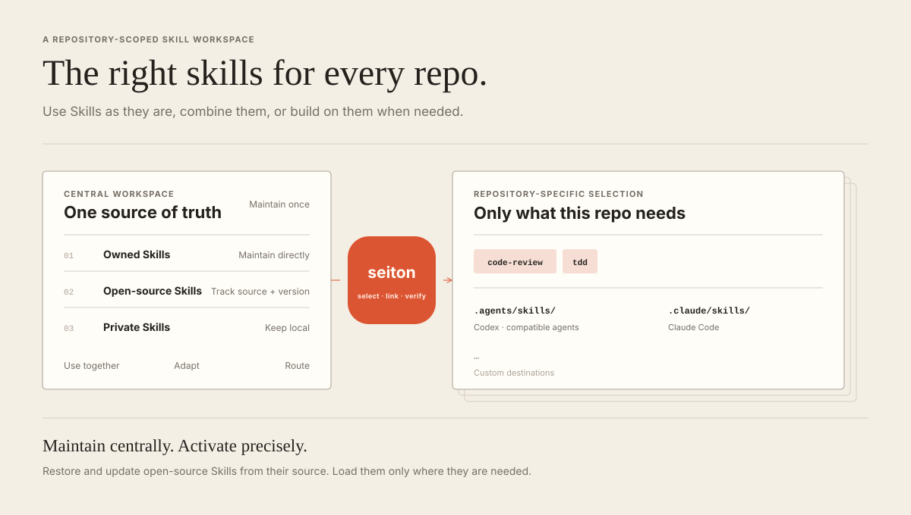

<h1 align="center">seiton</h1>

<p align="center">A central Skill workspace for coding agents. Keep owned, private, and open-source Skills in one place, then activate only what each repository needs.</p>

<!-- <p align="center">
  <a href="LICENSE"></a>
</p> -->



## Why

Skills are easy to install and easy to forget. Global installations grow
stale, add discovery context to every session, and spread Skill management
across agent-specific directories.

seiton instead:

- keeps owned, private, and open-source Skills in one source of truth;
- activates an exact Seiton-managed overlay for each repository;
- allows an empty overlay with `minimal`;
- switches Codex and Claude Code together;
- restores and updates open-source Skills without committing downloaded copies;
- lets you use Skills unchanged, combine them, or build on them.

`npx skills` handles open-source Skill installation and updates. seiton adds
the central catalog and repository-specific selection. Its bundled `seiton`
control Skill is available but never activated implicitly.

## Workspace structure

```text
~/seiton/
├── seiton/                     Optional bundled control Skill
├── owned/                      Skills you maintain
│   └── <skill>/
├── external/
│   └── skills-lock.json        Open-source Skill sources
├── local/                      Private Skills, ignored
├── scripts/                    CLI and validator
└── skillsets.toml              Reusable selections
```

The workspace can be its own Git repository and sync across machines.
Downloaded open-source Skill copies, private Skills, and repository links stay
uncommitted.

## Install

### Requirements

- Python 3.11 or newer
- Node.js 22.20 or newer with `npx`
- macOS or Linux

Create a clean workspace:

```sh
npx seiton@latest init
```

This creates `~/seiton`, installs the `seiton` command in `~/.local/bin`, and
starts with no owned Skills, open-source dependencies, profiles, or active
overlay. The bundled control Skill is present but optional. To use another
location:

```sh
npx seiton@latest init ~/Tools/seiton
```

Ensure `~/.local/bin` is on `PATH`. The command is available globally; your
Skills are not installed globally.

## Use

Project commands can run anywhere inside a Git repository:

```sh
seiton
seiton status [--project PATH] [--json]
seiton list [--project PATH] [--json]
seiton use SKILL... [--project PATH] [--dry-run] [--json]
seiton use --profile NAME [--project PATH] [--dry-run] [--json]
seiton minimal [--project PATH] [--dry-run] [--json]
seiton check [--project PATH] [--json]
```

`ls` remains an alias for `list`. Skill names and `--profile` are mutually
exclusive. The catalog commands do not require a Git project:

```sh
seiton add SOURCE SKILL... [--json]
seiton add SOURCE --all [--json]
seiton restore [--json]
seiton update SKILL... [--json]
seiton update --all [--json]
```

seiton links the selected Skills into:

- Codex and compatible agents: `<repo>/.agents/skills/<name>`
- Claude Code: `<repo>/.claude/skills/<name>`

These are machine-specific absolute symlinks. Add the generated directories to
each target repository's ignore rules unless that repository intentionally
tracks its own Skill links:

```gitignore
.agents/skills/
.claude/skills/
```

## Build your catalog

Add a Skill you maintain directly to the workspace:

```text
~/seiton/owned/my-skill/SKILL.md
```

Keep a private or unverified Skill under the ignored `local/` directory:

```text
~/seiton/local/my-private-skill/SKILL.md
```

Add an open-source Skill to the catalog:

```sh
seiton add owner/repository skill-name
seiton add owner/repository one two --json
```

Register every Skill only when the entire source has been reviewed:

```sh
seiton add owner/repository --all --json
```

An empty `add` is rejected. Seiton never exposes upstream global installation:
it always supplies explicit Skill names, the two supported clients, and
`--yes`. Registering every Skill is not a recommendation to activate
everything. `add` never changes project links or profiles; run `seiton use
skill-name` separately when needed.

Seiton delegates these operations to the fixed compatible version
`skills@1.5.21` for Codex and Claude Code only.

Commit `external/skills-lock.json`, not the downloaded source. Restore the
catalog on another machine with:

```sh
seiton restore
```

Define a reusable selection in `skillsets.toml`:

```toml
[profiles.my-work]
skills = ["my-skill", "tdd"]
```

Machine-specific profile overrides belong in the ignored
`.agent/skillsets.toml`. A local profile with the same name replaces the shared
profile.

## Conversational selection

The bundled control Skill is optional. After `seiton use seiton`, invoke
`$seiton` without arguments to
choose a profile, custom set, or minimal mode. It:

1. reads the catalog and current selection;
2. groups Skills by source;
3. previews the exact link and context changes;
4. asks for confirmation;
5. applies the selection and verifies the result.

Newly linked Skills can be used explicitly in the current session. Start a new
session only when you need native `$name` discovery or implicit triggering.
`minimal` changes future discovery; it cannot remove context already loaded by
the current session.

For a one-off open-source Skill that should not join the catalog, use
`npx skills use` directly.

## Context estimates

`status` and selection previews report a dependency-free approximation:

- discovery tokens: Skill `name` plus `description`;
- body tokens: full `SKILL.md` content if every active Skill were invoked.

References, scripts, tool output, system Skills, and plugin Skills are excluded.
These estimates help compare selections; they are not billing or
remaining-context measurements.

## Maintain the catalog

Update locked open-source Skills explicitly:

```sh
seiton update tdd codebase-design
seiton update --all
```

An empty `seiton update` is rejected. Central updates are immediately visible
to every project linked to the changed Skills. Commit the changed
`external/skills-lock.json`. The lock records sources, Skill paths, and hashes;
current entries do not pin upstream commits.

Update an npm-installed seiton core without touching user content:

```sh
npx seiton@latest upgrade
```

Pass the workspace path after `upgrade` if it is not `~/seiton`. Core upgrades
replace only `scripts/` and `seiton/`. They preserve `owned/`, `local/`,
`external/skills-lock.json`, `skillsets.toml`, `.gitignore`, and the workspace
README. Maintainer clones should update with Git instead.

Run validation after catalog changes:

```sh
seiton check
```

## Development

Run the CLI tests, installer tests, repository check, and package boundary
audit:

```sh
npm test
npm run check
npm pack --dry-run
```

## License

seiton core and the original contents of this source repository are available
under the [MIT License](LICENSE). User-defined and open-source Skills retain
their own licenses.
